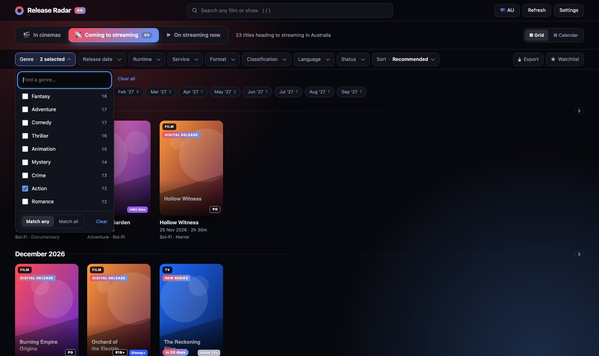
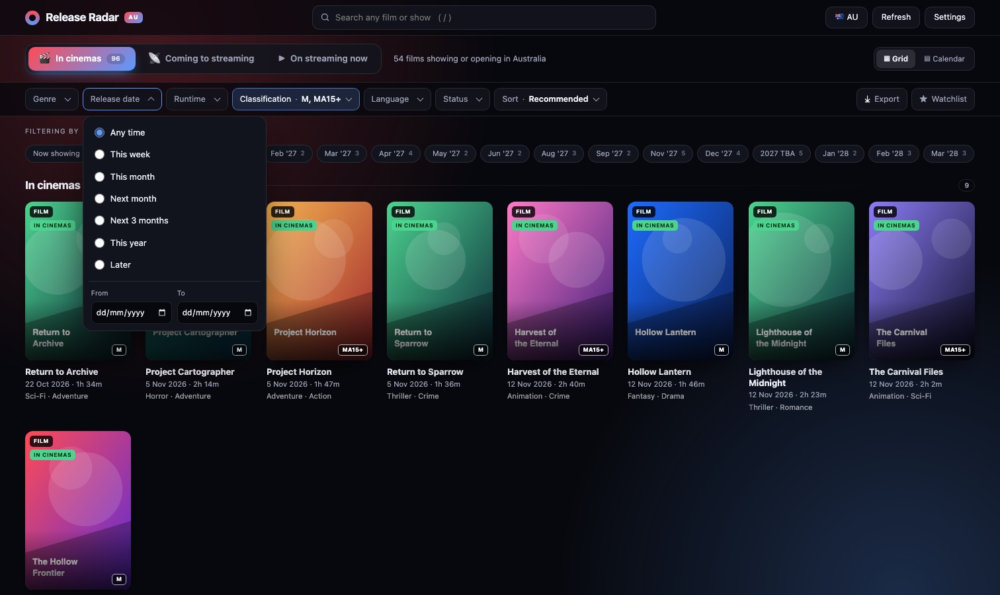
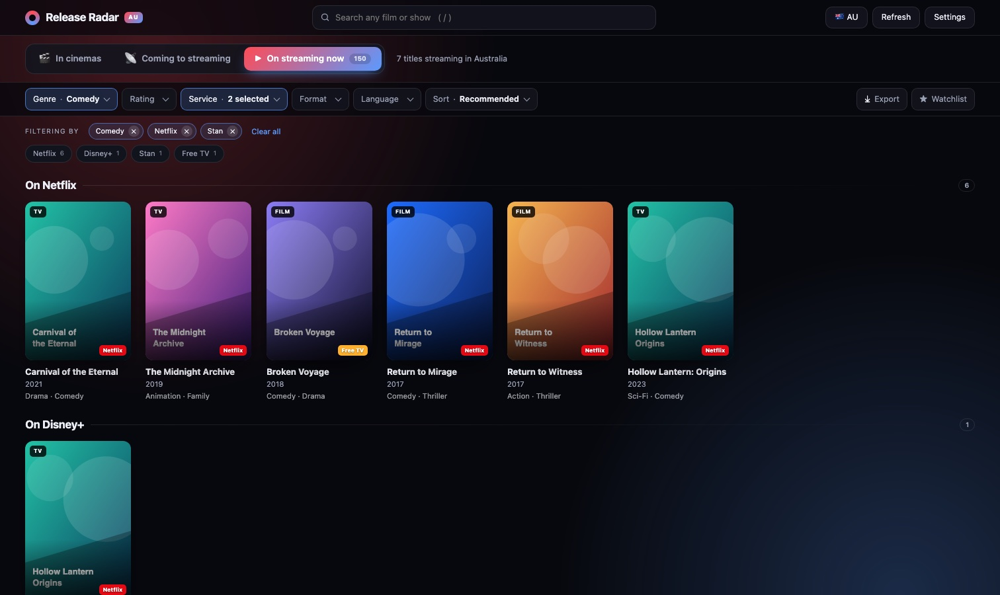
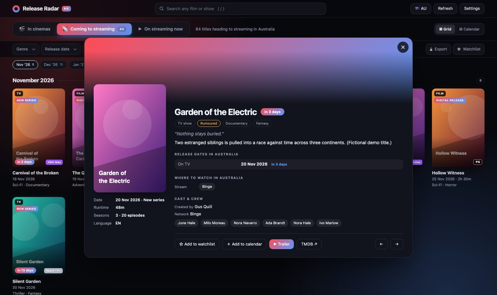
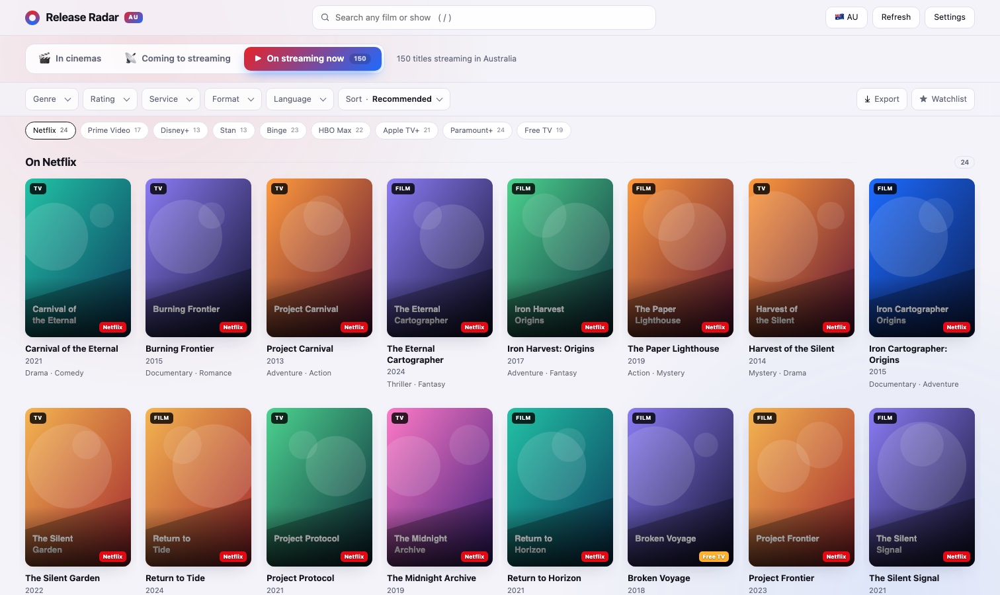
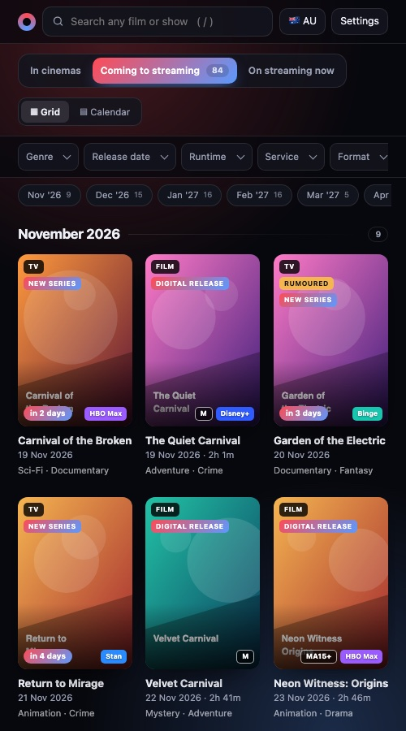
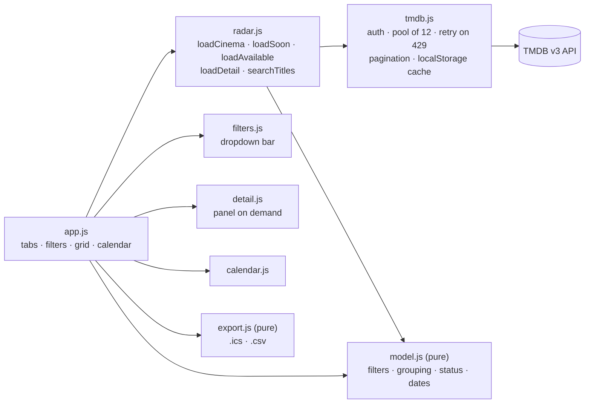

<div align="center">

# 🎬 Release Radar AU

**What's in Australian cinemas, and what's heading to Netflix, Prime Video, Disney+, Stan, Binge, HBO Max and more.**
One calendar-accurate place instead of a dozen entertainment sites.


</div>

> [!NOTE]
> Every screenshot in this README is taken in **demo mode** (`?demo`), which uses *fictional* titles so the app can be explored, tested and photographed without an API key. Nothing in them is real release data.

---

## Project status

| Area | State |
|---|---|
| Interface (all three views, filters, calendar, detail panel, exports, responsive layout) | Built and checked in a real browser through **demo mode** |
| Pure logic (filters, status/delay inference, date ranges, release-type parsing, calendar grid, `.ics`/CSV) | Unit-tested (`npm test`) |
| TMDB integration (`radar.js`, `tmdb.js`) | Written against TMDB's documented v3 API, with network IDs taken from TMDB's public export. **Not yet exercised end-to-end against live TMDB data in development**, so expect to tune field handling once you run it with a real key. Please open an issue with the console output if something looks off |

## Why this exists

Studios announce release dates years ahead, then move them. Cinema openings differ by country. Streaming platforms rarely say when something is being added. The information exists, but it's scattered across dozens of ad-heavy sites, and nobody gathers it for **Australian** viewers (where films open on Thursdays, the classification system is G / PG / M / MA15+ / R18+, and half the platforms you actually use, such as Stan, Binge and ABC iview, barely register on US-centric sites).

Release Radar pulls it into three views that answer the three questions people really ask:

| | View | Answers |
|---|---|---|
| 🎬 | **In cinemas** | What's showing now and what's opening, with *Australian* dates and classifications |
| 📡 | **Coming to streaming** | Which films are about to hit digital/streaming, and which new series and seasons each service is premiering |
| ▶ | **On streaming now** | What's already on each service, most popular first |

## Screenshots

<table>
  <tr>
    <td width="50%"><br><sub><b>Coming to streaming.</b> Dropdown filters with live counts, platform badges and Match any/all.</sub></td>
    <td width="50%"><br><sub><b>Calendar view.</b> Month grid, Monday-first, with Thursday openings clearly visible.</sub></td>
  </tr>
  <tr>
    <td><br><sub><b>Release date &amp; classification.</b> Presets or a custom range; filter by M, MA15+ and so on.</sub></td>
    <td><br><sub><b>Streaming now.</b> Multi-service selection, removable filter chips, grouped by platform.</sub></td>
  </tr>
  <tr>
    <td><br><sub><b>Detail panel.</b> Cast, runtime, release timeline, where to watch, trailer, add to calendar.</sub></td>
    <td><br><sub><b>Light and dark</b> follow your system setting.</sub></td>
  </tr>
</table>

<p align="center"><br><sub>Responsive down to phone width. The app is tuned first for a 14″ laptop (1512 × 982).</sub></p>

## Features

**Know what's coming**
- **Regional cinema dates.** Uses TMDB's per-country release types, so you see the *Australian* wide/limited release date, not the US one.
- **Digital release dates.** Cinema titles heading to home/streaming, with the date TMDB lists for Australia.
- **New series and seasons per platform.** Netflix, Prime Video, Disney+, Stan, Binge, HBO Max, Apple TV+, Paramount+ and Free TV (ABC iview, SBS On Demand, 7plus, 9Now, 10 Play).
- **Honest status on every title:** *In cinemas now*, *Confirmed*, *Rumoured*, or *Delayed* (see [How delays are detected](#how-delays-are-detected)).
- **Countdowns** ("in 12 days") and Australian date format (18 Dec 2026).

**Find the right thing fast**
- **Dropdown filter bar** with Genre (multi-select with live counts, search, match any/all), Release date (presets or custom range), Runtime (range slider), Service (multi-select), Format, Classification, Language, Status, Rating and Sort. Menus only show what's relevant to the current view.
- **Active-filter chips** you can remove one at a time, plus *Clear all*.
- **Instant search**: results update on every keystroke, and a short pause later it also searches *all* of TMDB, so you can find a title that isn't in the lists.
- **Jump bar** that tracks your scroll position (Nov '26, Dec '26, and so on), **infinite scroll**, and a back-to-top button.
- **Grid or Calendar** layouts, with a hover synopsis on every poster.

**Make it yours**
- **Watchlist** (★ on any poster) and a one-click *Watchlist only* filter.
- **Add to calendar** for one title, a whole filtered list, or your watchlist, via standard `.ics` files that work with Apple Calendar, Google Calendar and Outlook.
- **Export** the current list as CSV.
- **Region switcher** (Australia by default; NZ, US, UK and more).

**Fast and respectful of the API**
- Stale-while-revalidate: your last results paint instantly, then refresh in the background.
- Titles stream onto the page as they resolve, soonest first.
- Cached responses are trimmed before they're stored, requests are pooled and retried on rate limits, and expensive lists load lazily per service.

## Quick start

You need a free TMDB API key (a v3 key or v4 read token): <https://www.themoviedb.org/settings/api>

```bash
git clone <this repo> && cd ReleaseRadar
npm start            # serves the folder on http://localhost:5173 (any static server works)
```

Open <http://localhost:5173>, click **Settings**, paste your key, and pick your region. The key is stored only in your browser's `localStorage` and is sent only to `api.themoviedb.org`.

**No key yet?** Open <http://localhost:5173/?demo> to explore the whole interface with fictional titles.

There is no build step, no bundler and no runtime dependency; it is plain ES modules.

## Using it

| Do this | To get this |
|---|---|
| Click a tab | Switch between **In cinemas**, **Coming to streaming** and **On streaming now** |
| Open **Genre**, tick several | Titles matching any of them (or all, with *Match all*). Counts update as you filter |
| Open **Release date** | Preset ranges (this week, next 3 months…) or a custom from/to |
| Open **Classification** | Narrow to e.g. M and MA15+ (cinema and streaming-soon views) |
| Open **Service** | Pick one or more platforms (streaming views) |
| Open **Sort** | Recommended, most popular, release date, highest rated, A–Z; group streaming-soon by date or platform |
| Press `/` | Focus search |
| Click a poster | Open the detail panel; use `←` `→` to step through the list |
| **Calendar** toggle | Month grid of the current list |
| **Export** | CSV of the list, or `.ics` for the list or your watchlist |
| `Esc` | Close a menu or panel |

### Australia specifics

- **Region defaults to Australia (`AU`)**, and requests use `language=en-AU`.
- Cinema openings in Australia are on **Thursdays**; the calendar makes that obvious.
- Classifications shown are the Australian ones (G, PG, M, MA15+, R18+) as reported by TMDB.
- **Stan**, **Binge** and **Free TV** are first-class services, alongside the global ones.
- Prefer another country? Change the region in Settings; dates, classifications and platform availability all follow it. (Stan and Binge only exist in Australia, and the app tells you when a service isn't listed for your region.)

## How it works



### What comes from where

| View | TMDB data | Notes |
|---|---|---|
| **In cinemas** | `discover/movie` with `region`, `with_release_type=2\|3` (limited/wide cinema), from 5 weeks ago to 18 months out, most popular first; then each title's `release_dates` | The date shown is the regional cinema date, plus classification and runtime |
| **Coming to streaming** (movies) | `discover/movie` with `with_release_type=4` (digital) over the next ~4 months; `release_dates` for the date; `watch/providers` for platforms | Platform is shown only when TMDB knows it |
| **Coming to streaming** (TV) | `discover/tv` per service via `with_networks`, for new series (`first_air_date`) and new seasons (next episode is S?E1) | Service is known from the network |
| **On streaming now** | `discover/movie` + `discover/tv` with `with_watch_providers`, `watch_region` and flatrate/free/ads | Top ~120 per service, most popular first |
| **Detail panel** | `movie/{id}` / `tv/{id}` with `credits`, `videos`, `release_dates`, `watch/providers` | Fetched on demand and cached |
| **Search** | `search/multi` | Local results are instant; this adds titles beyond the loaded lists |

Genres are normalised between TMDB's movie and TV lists (for example "Sci-Fi & Fantasy" becomes *Sci-Fi* and *Fantasy*) so one filter works across both.
Network IDs for the streaming services come from TMDB's public `tv_network_ids` export.

### What TMDB does not know (and how the app handles it)

TMDB has **no "added to Netflix on date X" feed**, so the *Coming to streaming* view is built from what *can* be known:

- a film's **digital release date** (when it becomes available to watch at home, often as a rental first),
- a **series' or season's premiere** on a specific service's network.

Platforms for unreleased films are shown only when TMDB lists them; otherwise the card says so rather than guessing.

### How delays are detected

TMDB exposes no "delayed" flag either, so it's inferred. The first date the app sees for a title (per region and view) is remembered in your browser. If a later fetch reports a *later* date, the title is marked **Delayed** and the original date is shown struck through. If a date moves earlier, the flag clears. It's per-browser and starts from your first visit. Other statuses: **Rumoured** means TMDB says *Rumored/Planned* or only has a year-level placeholder (Jan 1); **In cinemas now** means the regional cinema date has passed.

### Caching and performance

| Layer | Behaviour |
|---|---|
| Response cache | `localStorage`, TTL: genres/providers 7 days, lists 6 hours, details 24 hours. Responses are trimmed to only the fields used |
| View snapshots | Each view's results are saved per region; a snapshot younger than 20 minutes skips the network entirely, an older one paints instantly then refreshes |
| Request pool | 12 concurrent requests, retry with back-off on HTTP 429 |
| Rendering | Cards are built once and reused, long lists render in pages (infinite scroll), offscreen cards skip layout (`content-visibility`), and live-streamed results re-render at most every 350 ms |

## Project structure

```
index.html            page shell
css/styles.css        design tokens, light/dark, responsive (14" first)
js/
  app.js              state, loading, rendering, wiring
  filters.js          the dropdown filter bar + active-filter chips
  detail.js           title detail panel
  calendar.js         month-grid view
  radar.js            TMDB data pipeline (cinema, soon, now, detail, search)
  tmdb.js             API client: auth, pool, retry, pagination, cache
  model.js            PURE logic: filters, status, grouping, dates, release types
  export.js           PURE: .ics and CSV builders
  demo.js             fictional data for ?demo
  ui.js               DOM/storage helpers
test/model.test.js    unit tests for the pure logic
scripts/screenshots.sh  regenerates docs/screenshots from demo mode
```

## Development

```bash
npm test             # unit tests (Node's built-in runner, no dependencies)
npm run screenshots  # regenerate docs/screenshots (needs Google Chrome)
```

The tests cover the logic most likely to be subtly wrong: release-type parsing, status and delay inference, date presets, the calendar grid, genre/service/runtime/rating filtering, sorting and grouping, and the `.ics`/CSV exporters.

**Demo mode** accepts URL parameters (used by the screenshot script), for example:
`/?demo&mode=soon&genres=Action,Sci-Fi&services=stan&view=calendar&open=genre&detail=2`

## Deploying

It's a static site, so GitHub Pages, Netlify, Cloudflare Pages or any file host works; publish the repo root. **No secrets are involved:** each visitor pastes their *own* free TMDB key into Settings, and it never leaves their browser except to call TMDB. (That also keeps you within TMDB's per-key rate limits.)

## Privacy

No analytics, no tracking, no backend. Your API key, region, filters, watchlist and cached data live in your browser's `localStorage`. Clearing site data resets everything.

## Known limits

- Data is only as good as TMDB's crowd-sourced data, so dates can be wrong or move; that's why each title shows a status.
- Lists cover the **most popular** titles (a few hundred per view), not all of TMDB; search reaches beyond them.
- No notifications or reminders; use *Add to calendar* instead.
- "Delayed" detection needs at least two visits to see a change.

## Roadmap ideas

Reminders via a service worker, a shareable link for a filtered view, cinema session times (needs a different data source), and a "leaving soon" view if a reliable source appears.

## Credits & licence

- Film and TV metadata, images and streaming availability by **[TMDB](https://www.themoviedb.org/)**. *This product uses the TMDB API but is not endorsed or certified by TMDB.* Streaming-availability data on TMDB is provided by JustWatch.
- Code is released under the **Apache-2.0** licence (see [LICENSE](LICENSE)).
- TMDB's API terms apply to your use of their data. The free API is for **non-commercial** use.
