<div align="center">

# 🎬 Release Radar AU

**What's in Australian cinemas, what's heading to streaming, and what's already on Netflix, Prime Video, Disney+, Stan, Binge, HBO Max and more.**
One place, with Australian dates, an on-device AI that understands what you're in the mood for, and a group picker that ends the "what do we watch?" argument.


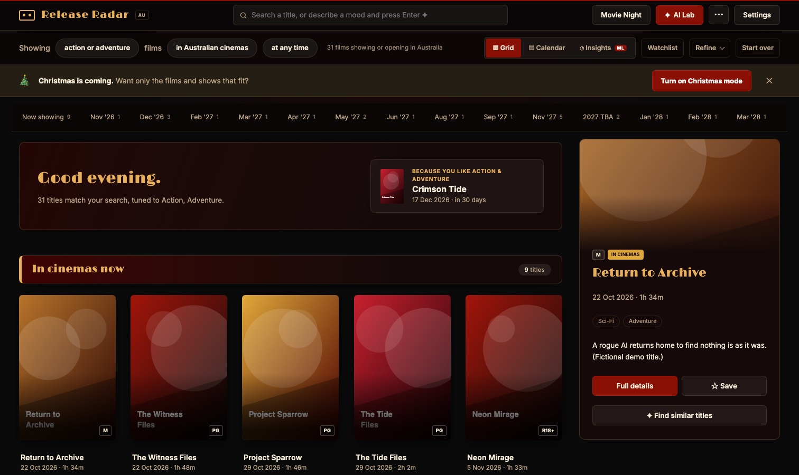

[**▶ Live demo**](https://zac-knight.github.io/ReleaseRadar/) · [Quick start](#quick-start) · [What makes it different](#what-makes-it-different) · [Screenshots](#screenshots) · [Features](#features) · [AI & data science](#ai-machine-learning--data-science) · [How it works](#how-it-works) · [Development](#development)

</div>

> [!TIP]
> **Try it now: <https://zac-knight.github.io/ReleaseRadar/>**. With no API key it opens in demo mode (fictional titles), so you can explore everything: the guided questions, AI Lab, Movie Night, Insights and the seasonal themes. Add your own free TMDB key in Settings for real data.

> [!NOTE]
> Every screenshot here was taken in **demo mode** (`?demo`), which uses *fictional* titles so the app can be explored and photographed without an API key. None of it is real release data.

---

## Why this exists

Studios announce release dates years ahead, then move them. Cinema openings differ by country. Streaming services rarely say when something is being added. And US-centric sites barely register the services Australians actually use (Stan, Binge, ABC iview), or show American dates.

Release Radar doesn't greet you with a wall of filters. It **asks a few questions** and shows exactly that:

1. **What are you looking for?** Coming to **cinemas**, coming to **streaming**, or what's on streaming **now**
2. **Movies, TV shows, or both?**
3. **What kind of story?** Pick any genres, with live counts and example films for each
4. **Where do you watch?** Netflix, Prime Video, Disney+, Stan, Binge, HBO Max, Apple TV+, Paramount+, Free TV
5. **When?** This week, this month, the next 3 months, or any time

Your answers become a sentence above the results, and every highlighted phrase is editable in one click:

> Showing **action or adventure** **movies** **coming to streaming** **on Netflix or Stan** **in the next 3 months**

## What makes it different

| | |
|---|---|
| 🧠 **On-device AI** | Describe a mood ("tense space thriller with a twist") and a sentence-transformer running **in your browser** finds titles that *mean* the same thing. No server, no ML API key, nothing about what you watch leaves your device. |
| 🍿 **Movie Night** | Everyone in the group names a few films they love; the app finds the one title the whole group will enjoy, shows who's *least* sold, and **explains why** in plain English, with the maths on screen. |
| 📊 **It measures itself** | An Insights view with real analytics, a PCA + k-means "film map", and an honest model report: neighbour hit-rate against a random baseline, silhouette score, taste-model AUC. |
| 🎄 **Seasonal modes** | Christmas, Halloween and Easter re-skin the whole app, animate it (snow, bats, petals), **and filter every list server-side** to titles TMDB tags with that season. |
| 🇦🇺 **Properly Australian** | Australian release dates and classifications, Thursday openings, and Stan, Binge and Free TV as first-class services. |
| 📱 **Built for phones too** | A dedicated phone layout with a thumb-reach tab bar, full-screen sheets and 44px touch targets. |
| ⚡ **Fast on repeat visits** | Last results paint instantly; vectors, responses, posters and app files are all cached; a film's details load while you hover it. |
| 🔒 **Private by design** | No analytics, no tracking, no backend. Your key, watchlist and taste profile live in your browser. |

---

## Quick start

You need a free TMDB API key (v3 key or v4 read token): <https://www.themoviedb.org/settings/api>

```bash
git clone <this repo> && cd ReleaseRadar
cp .env.example .env      # then put your key after TMDB_API_KEY=
npm start                 # http://localhost:5173
```

That's it. The dev server (`scripts/serve.py`) reads `.env` and hands the key to the app, so there's nothing to paste. If port 5173 is busy it uses the next free one and prints the URL.

- **No `.env`?** Open **Settings** in the app and paste a key instead. A key entered there overrides `.env` and is stored only in your browser.
- **No key at all?** Open <http://localhost:5173/?demo> to explore everything with fictional titles.
- There is **no build step, bundler or runtime dependency.** It's plain ES modules; any static file server works (only `serve.py` reads `.env`).
- You need internet for the full look: fonts load from Google Fonts, and the language model downloads once (about 25 MB) the first time you use an AI feature, then is cached.

---

## Screenshots

<table>
  <tr>
    <td width="50%">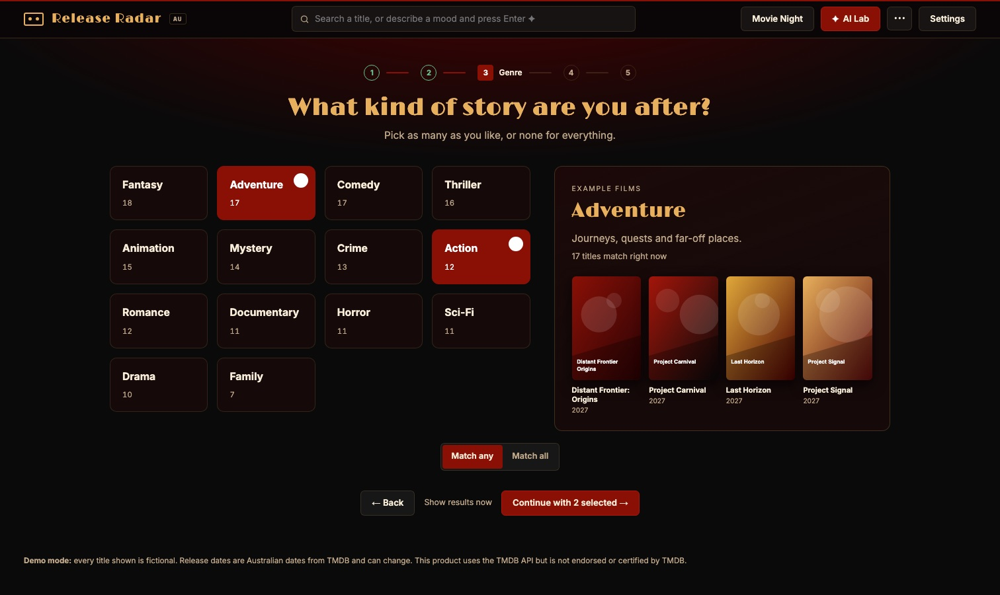<br><sub><b>Guided start.</b> Pick genres on the left; hover one and the right shows real example films for it.</sub></td>
    <td width="50%">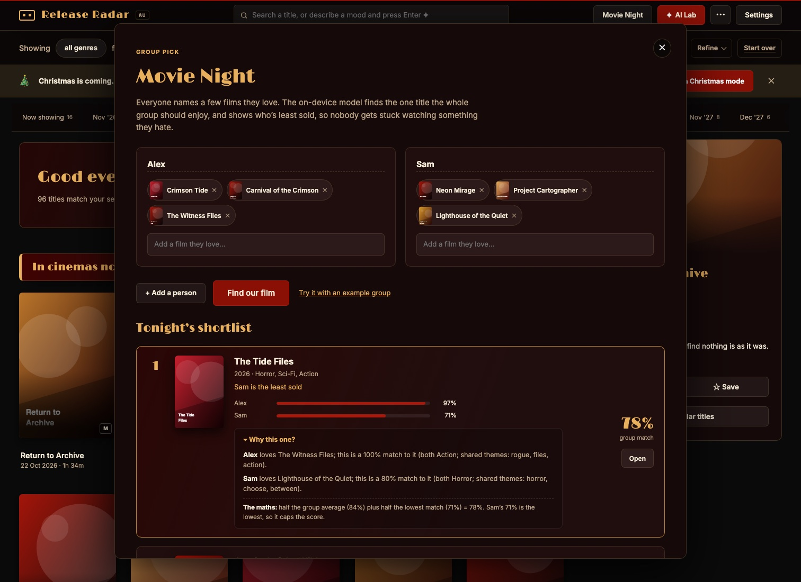<br><sub><b>Movie Night.</b> A group shortlist with per-person match bars and a "Why this one?" explanation.</sub></td>
  </tr>
  <tr>
    <td><br><sub><b>Grid + preview pane.</b> Rest on a poster and its backdrop, synopsis and actions appear on the right.</sub></td>
    <td>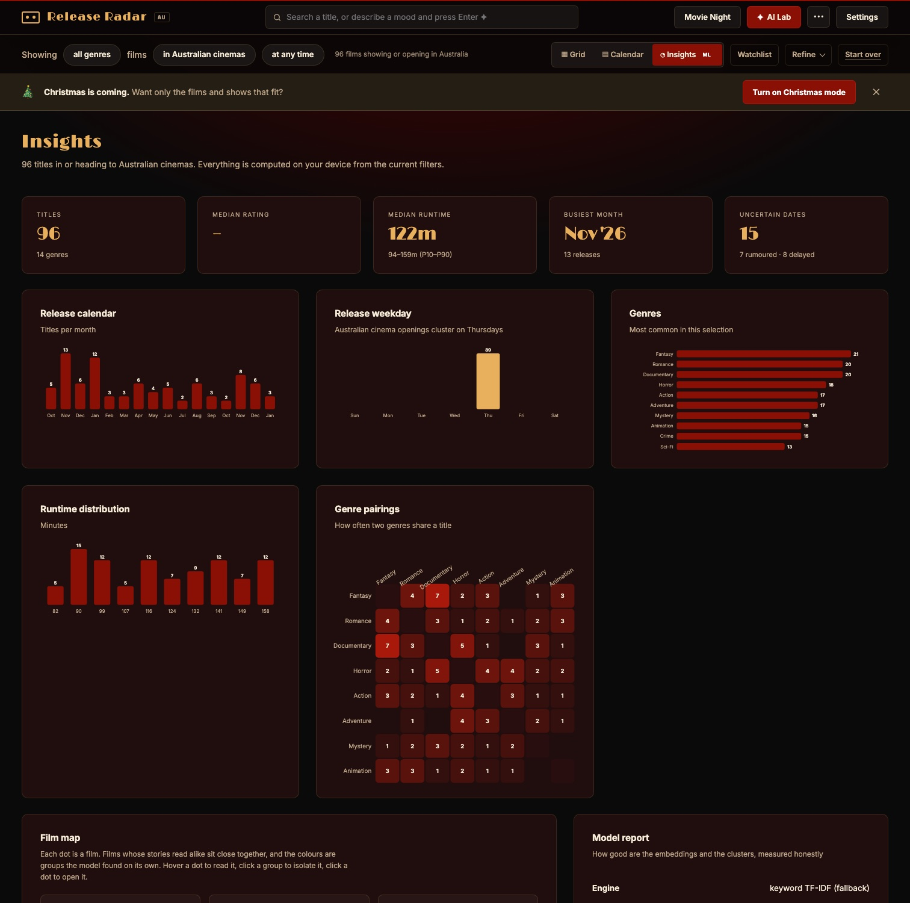<br><sub><b>Insights.</b> Analytics, a clustered film map, and a live model-evaluation report.</sub></td>
  </tr>
  <tr>
    <td>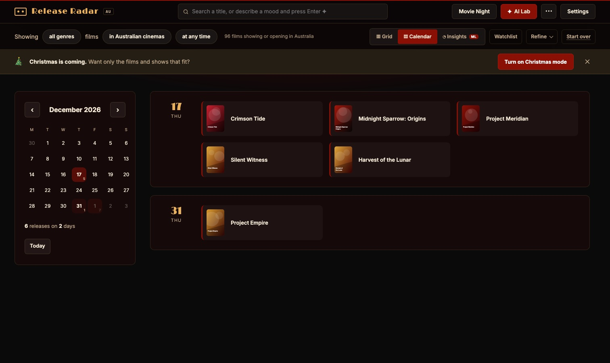<br><sub><b>Calendar.</b> A month picker shaded by release density beside a day-by-day agenda.</sub></td>
    <td><br><sub><b>Detail.</b> Takes on the film's own colour. Tabs for overview, cast &amp; crew, media, reviews, similar.</sub></td>
  </tr>
  <tr>
    <td>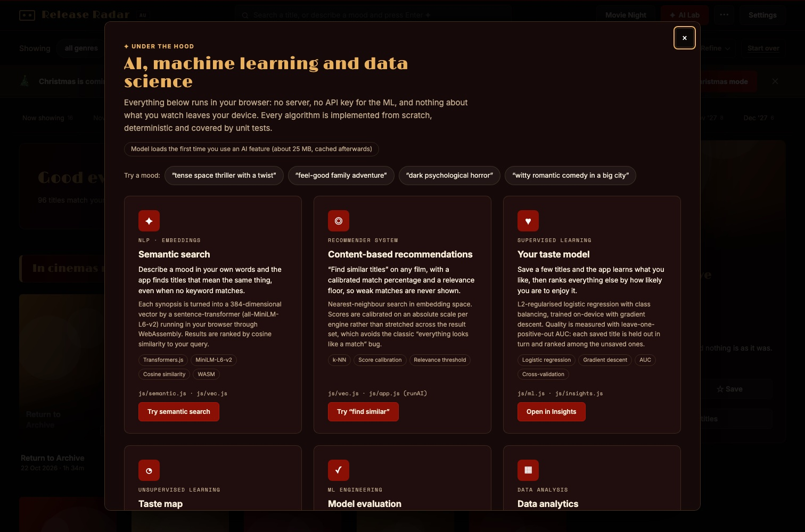<br><sub><b>AI Lab.</b> Every technique in plain language, the file it lives in, and a "Try it" button.</sub></td>
    <td>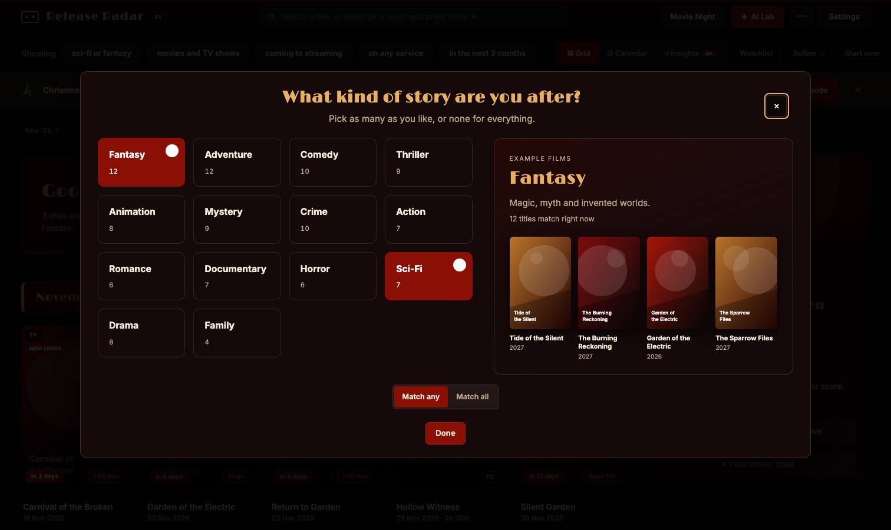<br><sub><b>Edit one phrase</b> of the sentence without starting over.</sub></td>
  </tr>
</table>

### Seasonal modes

<table>
  <tr>
    <td width="33%">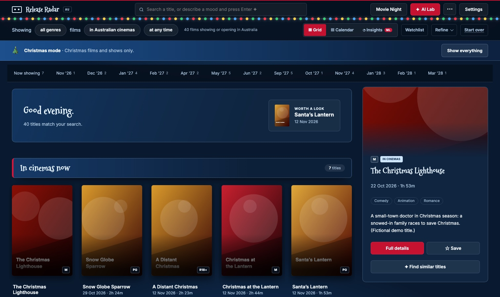<br><sub><b>🎄 Christmas:</b> winter-night blue and Christmas red, twinkling lights, falling snow.</sub></td>
    <td width="33%">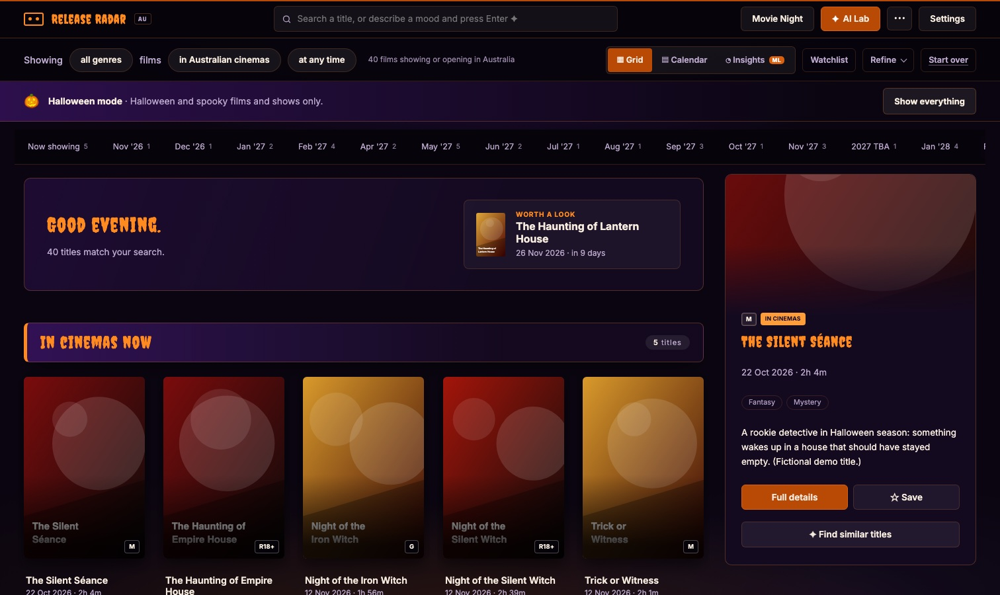<br><sub><b>🎃 Halloween:</b> ink and pumpkin orange, flickering wordmark, bats, embers and fog.</sub></td>
    <td width="33%">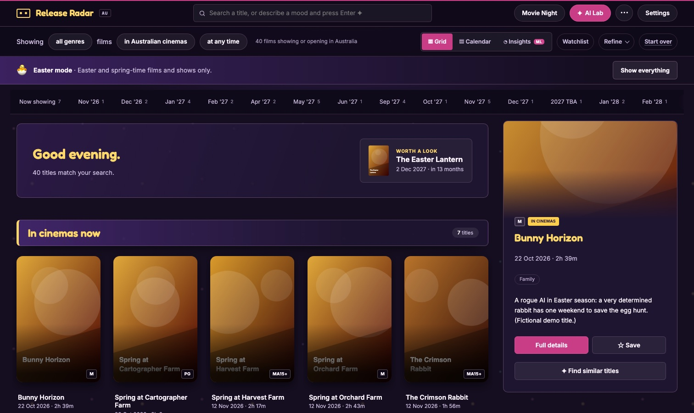<br><sub><b>🐣 Easter:</b> plum night with pastel pink, mint and butter, drifting petals, a hopping bunny.</sub></td>
  </tr>
</table>

<p align="center"><br><sub>The phone layout: two-row header, a scrolling search sentence, a bottom tab bar, full-screen sheets.</sub></p>

---

## Features

### Know what's coming
- **Regional cinema dates** from TMDB's per-country release types: the *Australian* date, not the US one.
- **Digital release dates** for cinema titles heading to home/streaming.
- **New series and seasons per platform** across nine services, including Free TV (ABC iview, SBS On Demand, 7plus, 9Now, 10 Play).
- **Honest status on every title:** *In cinemas now*, *Confirmed*, *Rumoured* or *Delayed* ([how delays are detected](#how-delays-are-detected)).
- **Countdowns** ("in 12 days") and Australian date formats.

### Find the right thing the way you'd think about it
- **A guided story, not a filter wall.** Single-choice answers advance automatically, you can skip any time, and returning visitors go straight to results.
- **Your search as a sentence.** Click a phrase to change just that part; **Start over** redoes the questions. Clicking the logo goes back to the start.
- **Genre picker with examples.** Hover or focus a genre to see its description, how many titles match right now, and four well-rated example posters from your current results.
- **Live counts** on genre and service tiles; tiles with no matches disappear.
- **Refine** (collapsed by default): date range, runtime, classification, language, status, rating, sort and export. Extra filters show as removable chips.
- **Search on every keystroke**, then a short pause later it searches *all* of TMDB. Type three or more words and press Enter for **semantic search**.
- **Clear group boundaries.** Each group (a month, a service) gets its own banner with a title count and a rule above it.
- **Helpful empty and error states** that point at the phrase that's narrowing things, or say what failed and offer *Try again*.

### Browse comfortably
- **Grid with a preview pane.** Rest on a poster (a short hover delay stops flicker) or focus it with the keyboard; the right-hand pane shows backdrop, rating, genres, synopsis, **Full details** and **Save**.
- **Calendar as month picker + agenda.** Days are shaded by how many releases they have; the agenda lists only days that have releases, with full titles.
- **A rich detail dialog.** Backdrop hero, trailer on click (privacy-friendly `youtube-nocookie`, never autoplays), a stat strip with a score ring, where to watch (with provider logos), release dates, and tabs for **Cast & crew** (photos), **Media**, **Reviews** and **Similar**. Step through titles with `←` `→`. The dialog takes on the dominant colour of the poster.
- **Seamless refresh.** Refresh keeps what's on screen, fetches fresh data behind it, updates titles in place and removes ones that no longer apply. No blank page, no spinner takeover.

### Make it yours
- **A greeting that knows you.** A time-of-day hello, how many titles arrive this week, and a featured pick chosen from your genres and saves ("Because you like Sci-Fi").
- **Watchlist** with **Undo** on every save/remove, plus a one-click *Watchlist only* filter.
- **Add to calendar** for one title, a filtered list or your watchlist (`.ics` for Apple Calendar, Google Calendar and Outlook), and **CSV export**.
- **Region switcher** (Australia by default; NZ, US, UK and more).

### Easy to use, everywhere
- **Keyboard:** `/` search · `1` `2` `3` Grid / Calendar / Insights · `M` Movie Night · `←` `→` in a film · `Esc` close · `?` help.
- **Back button closes dialogs** instead of leaving the app.
- **Accessibility:** skip-to-results link, clear focus outlines, ARIA live regions for status, `prefers-reduced-motion` respected (animations become still frames), 40px+ tap targets (44px on touch).
- **Phones:** a dedicated layout, not just a shrunken desktop. See [Phone layout](#phone-layout).

---

## AI, machine learning & data science

> **Click “✦ AI Lab” in the app header for an interactive tour of everything below.** It all runs in the browser.

| Discipline | What it does | Techniques | Where |
|---|---|---|---|
| **NLP / semantic search** | Describe a mood, get titles that mean the same thing | Sentence embeddings (MiniLM-L6-v2 via Transformers.js/WASM), cosine similarity | [`js/semantic.js`](js/semantic.js), [`js/vec.js`](js/vec.js) |
| **Recommender system** | "Find similar titles" with a calibrated match % | k-NN in embedding space, absolute score calibration, relevance floor | [`js/vec.js`](js/vec.js), [`js/app.js`](js/app.js) |
| **Group recommendation** | Movie Night: one pick for several people | Per-person taste centroids, average + least-misery social choice, fairness score, explanations | [`js/group.js`](js/group.js), [`js/night.js`](js/night.js) |
| **Supervised learning** | Learns your taste from saved titles | L2-regularised logistic regression, class balancing, leave-one-positive-out AUC | [`js/ml.js`](js/ml.js) |
| **Unsupervised learning** | The film map | PCA (power iteration), k-means++, *k* by silhouette, c-TF-IDF cluster labels | [`js/ml.js`](js/ml.js), [`js/insights.js`](js/insights.js) |
| **Model evaluation** | The app measures itself | Neighbour genre hit-rate@5 vs random baseline, silhouette, AUC | [`js/insights.js`](js/insights.js) |
| **Data analysis** | Release density, genre mix, distributions | Median/IQR/percentiles, histograms, co-occurrence matrix, hand-built SVG | [`js/insights.js`](js/insights.js) |
| **Data engineering** | Live TMDB ingestion | Pooled retrying client, response trimming, multi-layer caching, delay/rumour inference | [`js/radar.js`](js/radar.js), [`js/tmdb.js`](js/tmdb.js) |
| **Reliability** | Works without the neural model | Hashed TF-IDF fallback (feature hashing); the UI says which engine ran | [`js/semantic.js`](js/semantic.js) |

All the maths is implemented from scratch, seeded and deterministic, and unit-tested. Methodology, evaluation and honest limitations are in **[docs/ML.md](docs/ML.md)**.

### Honest match percentages

A common recommender bug is rescaling scores *within each result set*, so the best result always looks like a strong match, even when nothing is similar. Here, scores are calibrated on an **absolute scale per engine**, and anything below a relevance floor is dropped entirely rather than shown as a weak "41% match".

### Movie Night: group recommendation with explanations

Each person's taste is the centroid of the embeddings of the films they love. A candidate's **group score** is half the group's *average* match and half the *lowest* match (the "least misery" rule), so a film one person adores and another hates is pushed down. Each result shows a per-person bar, a plain-English verdict ("Sam is the least sold"), and a **Why this one?** panel: which of each person's picks it resembles most, the genres and rarest words they share, and the arithmetic behind the score.

### Seasonal modes: server-side filtering

Picking Christmas, Halloween or Easter doesn't just hide posters. Keyword names ("christmas", "santa claus", "halloween", "haunted house", "easter bunny"…) are looked up through TMDB's keyword search at run time (ids are never hard-coded) and passed to every `discover` query as `with_keywords`, so cinemas, coming-to-streaming and streaming-now all narrow at the source. Caches and snapshots are kept separately per season. Easter's date is computed (anonymous Gregorian algorithm), so its "coming up" prompt moves each year. Animations (snow, bats, petals) run on one click-through canvas **behind** the page content, pause in background tabs, and can be switched off in the `⋯` menu.

---

## How it works

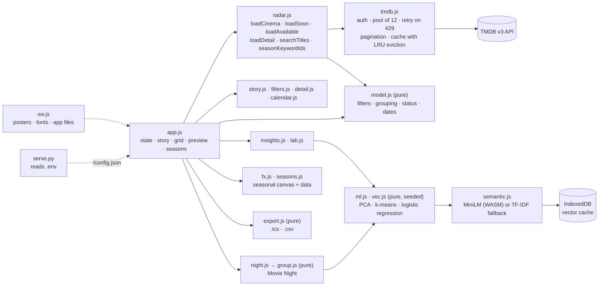

### What comes from where

| View | TMDB data | Notes |
|---|---|---|
| **In cinemas** | `discover/movie` with `region`, `with_release_type=2\|3`, from 5 weeks ago to 18 months out, most popular first; then each title's `release_dates` | Regional cinema date, plus classification and runtime |
| **Coming to streaming** (movies) | `discover/movie` with `with_release_type=4` (digital) over ~4 months; `release_dates`; `watch/providers` | Platform shown only when TMDB knows it |
| **Coming to streaming** (TV) | `discover/tv` per service via `with_networks`, for new series and new seasons | Service known from the network |
| **Streaming now** | `discover/movie` + `discover/tv` with `with_watch_providers`, `watch_region`, flatrate/free/ads | Top ~120 per service |
| **Detail** | `movie/{id}` / `tv/{id}` with `credits`, `videos`, `images`, `keywords`, `reviews`, `recommendations`, `external_ids`, `release_dates`, `watch/providers` | Fetched on demand (and prefetched on hover), cached |
| **Search** | `search/multi` | Local results are instant; this adds titles beyond the loaded lists |
| **Seasons** | `search/keyword`, then `with_keywords` on every `discover` above | Keyword ids resolved at run time |

Genres are normalised between TMDB's movie and TV lists (e.g. "Sci-Fi & Fantasy" becomes *Sci-Fi* and *Fantasy*) so one filter works across both.

### What TMDB does not know

TMDB has **no "added to Netflix on date X" feed**, so *Coming to streaming* is built from what can be known: a film's **digital release date**, and a **series' or season's premiere** on a service's network. Platforms for unreleased films are shown only when TMDB lists them. (A learned estimate of each film's streaming window is on the [roadmap](#roadmap).)

### How delays are detected

TMDB exposes no "delayed" flag either, so it's inferred. The first date the app sees for a title (per region and view) is remembered in your browser. If a later fetch reports a *later* date, the title is marked **Delayed** and the original date is struck through. This needs at least two visits to see a change.

### Caching: why repeat visits are fast

| Layer | What is kept | Where | Lifetime |
|---|---|---|---|
| Last results | The titles you were looking at, painted instantly on load, then refreshed | `localStorage` snapshot | Refreshed if older than 20 min |
| TMDB responses | Trimmed list and detail responses | `localStorage`, oldest evicted first when full | Lists 6 h, details 24 h |
| Language-model vectors | One embedding per synopsis, keyed by a hash of its text | IndexedDB ([`js/idb.js`](js/idb.js)) | Capped at 6,000, oldest dropped |
| Posters, fonts, libraries, app files | Static assets | Service worker ([`sw.js`](sw.js)) | Images cache-first; the rest stale-while-revalidate (network-first on localhost so dev edits show immediately) |
| Film details | Fetched while you hover a title, so the dialog opens ready | Same TMDB cache | 24 h |

Also: 12 pooled concurrent requests with back-off on HTTP 429, response trimming, cards built once and reused, infinite scroll, `content-visibility` for offscreen cards, and live results re-rendering at most every 350 ms. Per-season data is cached and snapshotted separately.

### Phone layout

Below 720px the app switches to a purpose-built layout ([`css/mobile.css`](css/mobile.css)): a two-row header (logo and actions, then a full-width search), the "Showing…" sentence and its actions as single sideways-scrolling rows, a **bottom tab bar** (Browse · Calendar · Insights · Movie Night · AI Lab), the Refine filters as a bottom sheet, dialogs as full-screen sheets, two-column posters, 16px inputs (no iOS zoom), safe-area padding for notches and home bars, and no hover-only behaviour on touch devices.

### Design

An original "movie night" theme (oxblood red, antique gold, near-black, one Art Deco display face for titles) that is deliberately calm: flat colour, thin borders, generous spacing. Seasonal modes re-skin it by redefining colour and font tokens only. Not affiliated with any streaming service. Fonts: Limelight, Inter and Space Mono (plus Creepster, Mountains of Christmas and Fredoka for the seasons), from Google Fonts.

---

## Project structure

```
index.html                page shell
sw.js                     service worker: posters, fonts, app files (offline-capable)
css/
  styles.css              base layout, components, tokens
  retro.css               the "movie night" theme (token-driven)
  seasons.css             Christmas / Halloween / Easter token sets + banners
  mobile.css              phone layout and tab bar
js/
  app.js                  state, loading, rendering, preview pane, seasons, wiring
  radar.js  tmdb.js       TMDB pipeline: loaders, client (pool, retry, cache, eviction)
  model.js                PURE: filters, status, grouping, dates
  story.js  filters.js    guided questions (with genre example panel) · Refine
  detail.js  calendar.js  detail dialog · month picker + agenda
  semantic.js             on-device embeddings (MiniLM / TF-IDF fallback) + persistent cache
  vec.js  ml.js           PURE: vectors, cosine, calibration · PCA, k-means, logistic regression
  group.js  night.js      PURE group-recommendation maths · Movie Night UI
  insights.js  lab.js     Insights view (charts, film map, model report) · AI Lab tour
  seasons.js  fx.js       PURE season data and dates · seasonal animation canvas
  idb.js  export.js       IndexedDB vector store · PURE .ics / .csv builders
  demo.js  ui.js          fictional data for ?demo · DOM/storage helpers
scripts/
  serve.py                no-cache dev server; serves the .env key at /config.json
  screenshots.sh          regenerates docs/screenshots from demo mode
test/                     model · vec · ml · group · seasons  (45 tests)
docs/ML.md                methodology, evaluation, limitations
.env.example              template for TMDB_API_KEY
```

---

## Development

```bash
npm start            # dev server (reads .env)
npm test             # unit tests (Node's built-in runner, no dependencies)
npm run screenshots  # regenerate docs/screenshots (needs Google Chrome)
```

**Tests (45)** cover the logic most likely to be subtly wrong: the story sentence, per-view filter scoping, release-type parsing, status and delay inference, date presets, the calendar grid, filtering/sorting/grouping, the `.ics`/CSV builders, the ML maths (k-means, PCA, silhouette, logistic regression, AUC), embedding calibration and cache keys, group ranking (including least-misery and explanations), and Easter's date plus season windows.

### Demo mode

Add `?demo` for fictional titles with no key. The screenshot script drives it with URL parameters, for example:
`/?demo&mode=soon&genres=Action,Sci-Fi&services=stan&when=3m&view=calendar`

| Parameter | Effect |
|---|---|
| `mode=cinema\|soon\|now` | Pick the view |
| `view=grid\|calendar\|insights` | Pick the layout |
| `guide=1` · `step=genre` · `edit=genre` | Show the questions, jump to a step, open the phrase editor |
| `season=christmas\|halloween\|easter` | Start in a seasonal mode |
| `night=1` · `night=run` · `lab=1` · `more=1` · `detail=2` · `refine=1` | Open Movie Night (optionally with an example group), the AI Lab, the `⋯` menu, a film, or Refine |
| `cal=2026-12` | Calendar month |
| `slow` | Hold the loading state |
| `noml` · `nosw` · `nofx` | Disable the neural model, the service worker, the seasonal animations |

### Status

| Area | State |
|---|---|
| Interface (story, views, Refine, calendar, preview pane, detail, Movie Night, seasons, phone layout) | Built and checked in a real browser through demo mode and screenshots |
| Pure logic and ML maths | Unit-tested |
| Core TMDB flows (cinemas, streaming now, detail) | Running against live TMDB data |
| Newer pieces: seasonal keyword filtering, the service worker, the IndexedDB vector cache, the neural model path, Movie Night on real titles, and the bat/bunny/sleigh animations | Exercised in demo mode and tests; not yet soak-tested against live data. Please open an issue with the console output if something looks off. |

---

## Deploying

It's a static site: GitHub Pages, Netlify, Cloudflare Pages or any file host works; publish the repo root. Static hosts don't run `serve.py`, so there's no `.env` there: each visitor pastes their *own* free TMDB key into Settings, and it never leaves their browser. (A shared key would be visible to anyone, so don't ship one.) The service worker serves cached app files first and updates in the background, so a new deploy appears on the *second* load.

## Privacy

No analytics, no tracking, no backend. Your key, region, filters, watchlist, season, and cached data live in your browser (`localStorage` and IndexedDB); clearing site data resets everything. Embeddings and your taste profile never leave the device. Trailers use `youtube-nocookie`, and only load when you press play. `.env` is git-ignored.

## Known limits

- Data is only as good as TMDB's crowd-sourced data, so dates can be wrong or move; that's why each title shows a status.
- Lists cover the **most popular** titles (a few hundred per view), not all of TMDB; search reaches beyond them.
- Seasonal filtering relies on TMDB's keyword tagging, so Easter in particular can return few titles.
- The keyword fallback is much weaker than the neural model; the UI tells you which one ran.
- No push notifications; use *Add to calendar*.
- "Delayed" detection needs at least two visits to see a change.

## Roadmap

- **Streaming-window predictor:** estimate when a film in cinemas will reach streaming, trained on past theatrical → digital gaps (genre, studio, popularity), reported with held-out error against a naive baseline.
- A small backend and scheduled data snapshot, so history (and delay detection) doesn't depend on one browser.
- Reminders via a service worker; shareable links for a filtered view.
- Cinema session times (needs another data source).
- RAG-style Q&A over reviews and synopses, with retrieval evaluation.

## Credits & licence

- Film and TV metadata, images and streaming availability by **[TMDB](https://www.themoviedb.org/)**. *This product uses the TMDB API but is not endorsed or certified by TMDB.* Streaming availability on TMDB is provided by JustWatch.
- Language model: [all-MiniLM-L6-v2](https://huggingface.co/Xenova/all-MiniLM-L6-v2) via [Transformers.js](https://github.com/huggingface/transformers.js).
- Code is released under the **Apache-2.0** licence (see [LICENSE](LICENSE)).
- TMDB's API terms apply to your use of their data. The free API is for **non-commercial** use.
